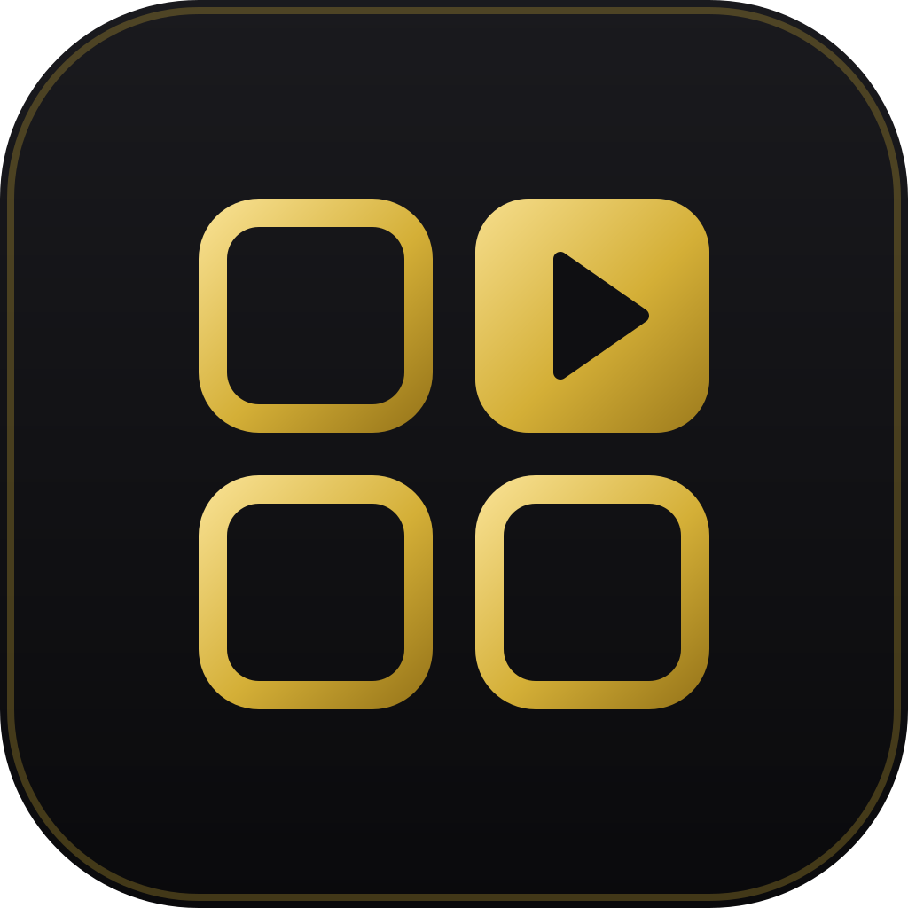
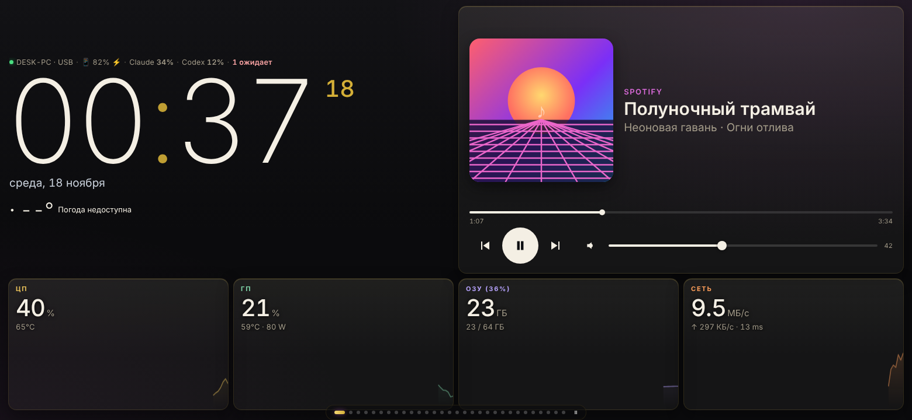

<p align="center"></p>

<h1 align="center">DeckBox PRO</h1>

<p align="center"><b>Превратите старый Android-телефон в настольную панель для компьютера.</b><br>
Статистика ПК, музыка, ярлыки, ИИ-сессии и сенсорное управление по USB или Wi-Fi.<br>
Windows, Linux и macOS. Без root, аккаунтов и облака.</p>

<p align="center">
  <a href="https://dubstep2004.github.io/DeckBox/"><b>Живое демо</b></a> ·
  <a href="https://github.com/Dubstep2004/DeckBox/releases/latest"><b>Скачать</b></a> ·
  <a href="#установка"><b>Установка</b></a>
</p>

<p align="center"><br>
<sub>Главная страница в оформлении PRO, демо-данные.</sub></p>

DeckBox состоит из двух частей: **приложения для Android**, которое работает на весь экран, и небольшого **агента на компьютере**, который передаёт на телефон данные. Панель настраивается в визуальном редакторе в браузере: 123 виджета, 30 шаблонов, несколько страниц и живой предпросмотр.

DeckBox основан на проекте [PhoneBox](https://github.com/ersinkoc/phonebox) (автор — ersinkoc, лицензия MIT). Отличия от оригинала:

- собственный дизайн **PRO** (графит и золото) на телефоне, в настройках и на сайте и новый значок;
- всё на русском: интерфейс, каталог виджетов, единицы измерения, сайт и документация;
- своё название везде: программа `DeckBoxAgent.exe`, приложение на телефоне, папки настроек;
- установщик для Windows на русском;
- обновления приходят из релизов DeckBox, а не PhoneBox.

## Возможности

| Для чего | Что показывает телефон |
|---|---|
| **Мониторинг ПК** | ЦП, ГП, ОЗУ, диски, сеть и пинг; графики, подробности о видеокарте, управление процессами |
| **Сенсорное управление** | Ярлыки программ и сайтов, сочетания клавиш и макросы; звук приложений, микрофон, медиа, OBS и системные функции |
| **На каждый день** | Сейчас играет, интернет-радио, часы, погода, календари, заметки, чек-листы, помидоро и таймеры |
| **ИИ и код** | Квоты Claude, Codex и Antigravity; сессии Claude Code и Codex; ревью и CI в GitHub |
| **Автоматизация** | Значения и уведомления через вебхуки, Home Assistant и правила, реагирующие на события на компьютере |

## Установка

Нужен телефон на **Android 7+** и компьютер. Для USB — кабель с передачей данных и включённая отладка по USB.

### Быстрая установка (Windows 10/11)

1. Скачайте `DeckBox-Setup-<версия>.exe` в разделе [Releases](https://github.com/Dubstep2004/DeckBox/releases).
2. Включите на телефоне **Для разработчиков → Отладка по USB** и подключите его кабелем.
3. Запустите установщик. Права администратора не нужны, .NET и Android Studio тоже.

Установщик поставит агент, adb и приложение на телефон. Если телефон не был подключён, приложение можно поставить позже: **Пуск → DeckBox → Установить приложение на телефон**.

Удаление: **Пуск → DeckBox → Удалить DeckBox** или «Параметры → Приложения».

Windows SmartScreen может предупредить, что программа неизвестна, потому что установщик не подписан. Нажмите «Подробнее → Выполнить в любом случае».

### Установка из исходников

#### 1. Агент на компьютере (Windows)

Установите .NET 10 SDK и adb:

```powershell
winget install Microsoft.DotNet.SDK.10 Google.PlatformTools
```

Скачайте проект: **Code → Download ZIP** на этой странице. Распакуйте его, например, в `C:\Users\<имя>\DeckBox`, затем в PowerShell выполните:

```powershell
cd C:\Users\<имя>\DeckBox
Set-ExecutionPolicy -Scope Process Bypass
.\scripts\install.ps1 -Autostart
```

`-Autostart` запускает агент вместе с Windows. На Linux и macOS используйте `./scripts/install.sh --autostart`.

#### 2. Телефон

1. Включите **Для разработчиков → Отладка по USB** и подключите телефон кабелем.
2. Установите приложение. Чтобы собрать его из исходников, добавьте к команде установки флаг `-Apk`. Для этого нужен Android Studio (JDK 17 и Android SDK 35).
3. Подтвердите на телефоне запрос «Разрешить отладку по USB?». Панель откроется сама.

Если на телефоне написано «PC not connected», выполните `adb devices`: телефон должен быть в статусе `device`, а не `unauthorized`.

### Настройка

Откройте <http://127.0.0.1:8765> или дважды щёлкните значок в трее Windows. Вверху справа выберите язык **Русский**. Во вкладке **Страницы** выберите шаблон, расставьте виджеты на сетке 12 × 6 и нажмите **Сохранить**.

Страницы на телефоне листаются свайпом, касанием точек или кнопками громкости.

#### Удаление

```powershell
.\scripts\uninstall.ps1
```

На Linux и macOS: `./scripts/uninstall.sh`. Добавьте `-Purge` (`--purge`), чтобы удалить и настройки.

## Где хранятся настройки

- Windows: `%APPDATA%\DeckBox\config.json`
- Linux: `~/.config/DeckBox`
- macOS: `~/Library/Application Support/DeckBox`

Переход с PhoneBox: при первом запуске DeckBox сам копирует старые настройки из папки `PhoneBox`, поэтому страницы, ярлыки и правила сохраняются. Старое приложение на телефоне установщик удаляет и ставит вместо него DeckBox. По USB телефон подключится сам, а для Wi-Fi его нужно один раз сопрячь заново.

## Документация

Подробные руководства (на английском; разделы о `setup.ps1` / `setup.sh` относятся к оригинальному PhoneBox, для DeckBox используйте установщик):

| Руководство | Содержание |
|---|---|
| [Установка и подключения](docs/SETUP.md) | USB, Wi-Fi, Tailscale, обновления и устранение неполадок |
| [Руководство пользователя](docs/GUIDE.md) | Шаблоны, виджеты, ИИ-интеграции, редактор, вебхуки и правила |
| [Внешний вид](docs/APPEARANCE.md) | Шрифты, поверхности, пресеты и предпросмотр |
| [Control Deck](docs/CONTROL-DECK.md) | Звук, медиа, OBS, ярлыки и задачи |
| [Discord](docs/DISCORD.md) | Подключение виджета Discord |
| [Разработка](docs/DEVELOPMENT.md) | Архитектура, демо, сборка и тесты |

## Безопасность

Настройки доступны только на этом компьютере (`127.0.0.1:8765`). Телефон по USB подключается через `adb reverse`, по Wi-Fi — через HTTPS на порту 8766 с закреплённым сертификатом. Команды и учётные данные остаются на компьютере: телефон передаёт только ID действия. Телеметрии и аккаунтов нет. Подробнее в [PRIVACY.md](PRIVACY.md).

## Лицензия

[MIT](LICENSE). Исходный проект — [PhoneBox](https://github.com/ersinkoc/phonebox) © ersinkoc.
