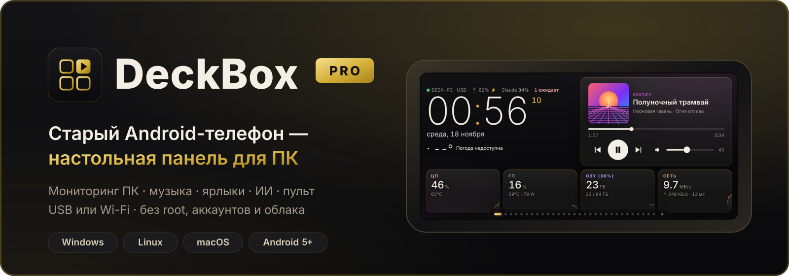
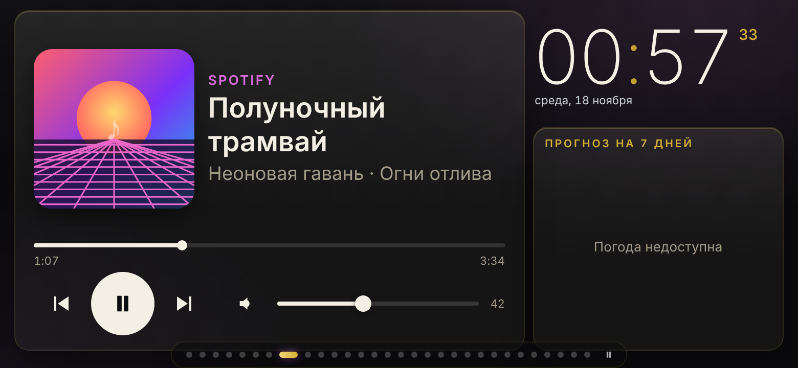
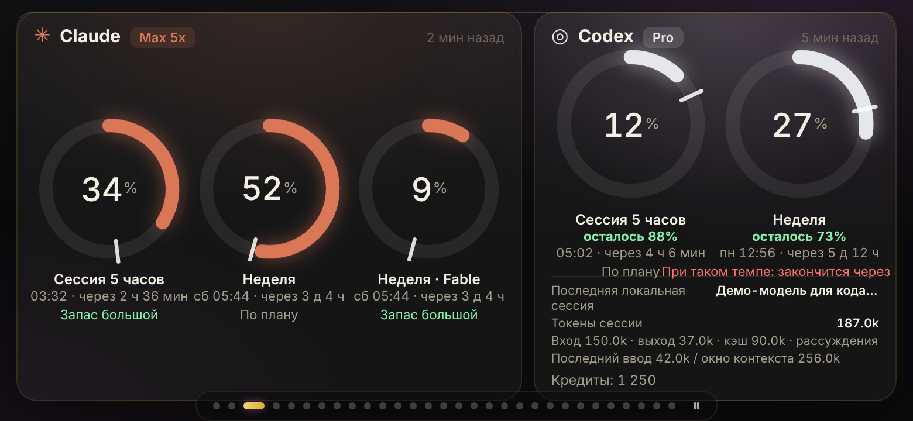
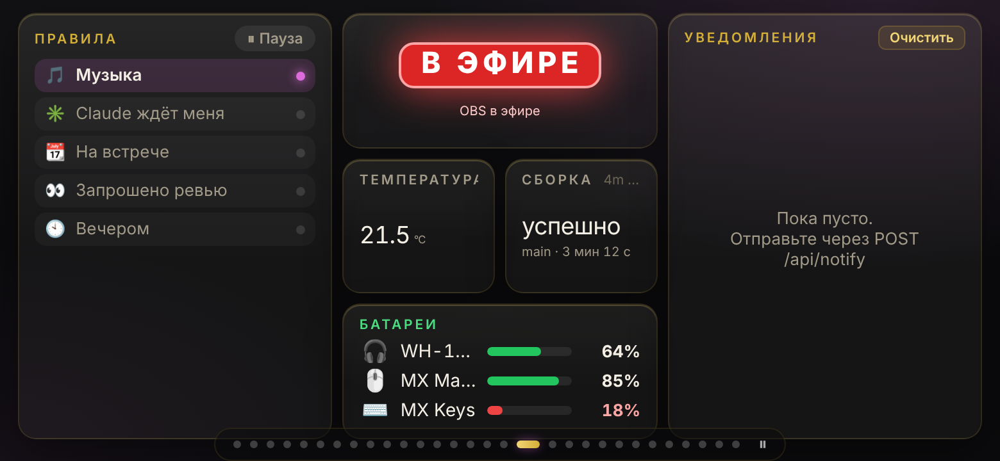

<p align="center">
  <a href="https://dubstep2004.github.io/DeckBox/"></a>
</p>

<p align="center">
  <a href="https://github.com/Dubstep2004/DeckBox/releases/latest"></a>
  <a href="https://github.com/Dubstep2004/DeckBox/releases"></a>
  
  
  <a href="LICENSE"></a>
</p>

<h3 align="center">
  <a href="https://github.com/Dubstep2004/DeckBox/releases/latest">⬇ Скачать</a>
  &nbsp;·&nbsp;
  <a href="https://dubstep2004.github.io/DeckBox/">▶ Живое демо</a>
  &nbsp;·&nbsp;
  <a href="#-установка">⚙ Установка</a>
  &nbsp;·&nbsp;
  <a href="docs/GUIDE.md">📖 Руководство</a>
</h3>

<br>

**DeckBox PRO** превращает старый Android-телефон в настольную панель для компьютера. На телефоне работает приложение
на весь экран, на компьютере — небольшой агент, который передаёт данные по USB или Wi-Fi. Страницы собираются в
визуальном редакторе прямо в браузере: **129 виджетов**, **33 шаблона**, сколько угодно страниц и живой предпросмотр.

<br>

## ✦ Возможности

<table>
<tr>
<td width="33%" valign="top">

### 📊 Мониторинг ПК
ЦП, ГП, ОЗУ, диски, сеть и пинг. Графики, подробности о видеокарте, самые тяжёлые процессы — и их завершение одним касанием.

</td>
<td width="33%" valign="top">

### 🎛 Пульт управления
Ярлыки программ и сайтов, сочетания клавиш, макросы. Звук приложений, микрофон, медиа, OBS, яркость, питание.

</td>
<td width="33%" valign="top">

### 🎵 На каждый день
Сейчас играет, интернет-радио, часы, погода, календари, заметки, чек-листы, помидоро и таймеры.

</td>
</tr>
<tr>
<td width="33%" valign="top">

### ✳ ИИ и код
Квоты Claude, Codex и Antigravity с прогнозом расхода, сессии Claude Code и Codex, ревью и CI в GitHub.

</td>
<td width="33%" valign="top">

### ⚡ Автоматизация
Вебхуки, Home Assistant и правила: панель сама показывает нужную страницу, когда играет музыка или ИИ ждёт ответа.

</td>
<td width="33%" valign="top">

### 🔒 Без облака
Без root, аккаунтов и телеметрии. Команды и ключи остаются на компьютере — телефон знает только их ID.

</td>
</tr>
</table>

<br>

## ⭐ Только в DeckBox PRO

<table>
<tr>
<td width="33%" valign="top">

### 📱 Панель
- 4 темы: золото, серебро, изумруд, рубин
- «Не беспокоить», курс ЦБ РФ, утренний брифинг
- Игровой режим с FPS и температурами
- Статистика за неделю, голосовые команды
- Жесты, анимированные обои
- Блокировка PIN-кодом

</td>
<td width="33%" valign="top">

### 🤖 Приложение
- Обновляется само: с компьютера или прямо с GitHub
- Докачка и проверка файла перед установкой
- Точка на значке, когда вышла новая версия
- Экран гаснет, когда компьютер спит
- Работает на Android 5.0 и новее

</td>
<td width="33%" valign="top">

### 💻 Компьютер
- Мастер первого запуска и магазин шаблонов
- Резервная копия настроек в один клик
- Обновление ночью и откат на прошлую версию
- Уведомление Windows о новой версии
- Всё на русском

</td>
</tr>
</table>

Что изменилось в каждой версии — в [истории изменений](CHANGELOG.md): метка у каждого пункта показывает, где
изменение — `📱 Панель`, `🤖 Приложение`, `💻 Компьютер` или `🌐 Сайт`.

<br>

## ✦ Как это выглядит

<table>
<tr>
<td width="50%"><p align="center"><b>Система</b> — ЦП, ГП, память, сеть</p></td>
<td width="50%"><p align="center"><b>Музыка</b> — трек, обложка, громкость</p></td>
</tr>
<tr>
<td width="50%"><p align="center"><b>Квоты ИИ</b> — лимиты и темп расхода</p></td>
<td width="50%"><p align="center"><b>Планировщик</b> — события и чек-лист</p></td>
</tr>
<tr>
<td width="50%"><p align="center"><b>Ярлыки</b> — кнопки в стиле Stream Deck</p></td>
<td width="50%"><p align="center"><b>Автоматизация</b> — правила и «В эфире»</p></td>
</tr>
</table>

<p align="center"><br>
<sub>Редактор страниц на компьютере: перетаскивайте виджеты, меняйте размер и параметры.</sub></p>

<p align="center"><sub>Все снимки — из <a href="https://dubstep2004.github.io/DeckBox/">живого демо</a> на придуманных данных. Ещё 13 шаблонов — в <a href="docs/GUIDE.md#страницы-и-шаблоны">руководстве</a>.</sub></p>

<br>

## ⚙ Установка

<table>
<tr>
<td width="33%" valign="top" align="center">

### 1
**Скачайте**<br>
[`DeckBox-Setup.exe`](https://github.com/Dubstep2004/DeckBox/releases/latest)<br>
<sub>Windows 10/11 x64</sub>

</td>
<td width="33%" valign="top" align="center">

### 2
**Подключите телефон**<br>
отладка по USB включена,<br>
кабель с передачей данных

</td>
<td width="33%" valign="top" align="center">

### 3
**Запустите установщик**<br>
агент, adb и приложение<br>
ставятся сами

</td>
</tr>
</table>

Права администратора, .NET и Android Studio не нужны. Затем откройте <http://127.0.0.1:8765> (или дважды щёлкните
значок в трее), выберите шаблон во вкладке **Страницы** и нажмите **Сохранить**. Страницы на телефоне листаются
свайпом, точками или кнопками громкости.

> [!NOTE]
> Установщик не подписан, поэтому Windows SmartScreen может предупредить о неизвестной программе: нажмите
> «Подробнее» → «Выполнить в любом случае». Отладку по USB разрешайте только своим компьютерам.

<details>
<summary><b>Как включить отладку по USB</b></summary>

1. *Настройки › О телефоне*: нажмите *Номер сборки* семь раз.
2. *Для разработчиков*: включите *Отладку по USB*. На Xiaomi, Redmi и POCO — ещё *Установку через USB*.
3. Подключите телефон и ответьте *Разрешить* на запрос *Разрешить отладку по USB?*.

Если телефон не был подключён во время установки: **Пуск › DeckBox › Установить приложение на телефон**.
Только Wi-Fi, без режима разработчика: поставьте `DeckBox-<версия>.apk` из релиза и сопрягите телефон по QR-коду в
**Настройки › Общие › Wi-Fi и Tailscale**.

</details>

<details>
<summary><b>Linux и macOS — из исходников</b></summary>

Нужны [.NET 10 SDK](https://dotnet.microsoft.com/download) и `adb`:

```sh
git clone https://github.com/Dubstep2004/DeckBox && cd DeckBox
./scripts/install.sh --autostart
```

Приложение для телефона — `DeckBox-<версия>.apk` из [релиза](https://github.com/Dubstep2004/DeckBox/releases/latest).
Подробности — в [руководстве по установке](docs/SETUP.md).

</details>

<details>
<summary><b>Обновления, удаление и переход с PhoneBox</b></summary>

- **Обновления** приходят сами: агент раз в 6 часов проверяет релизы DeckBox и обновляет себя и приложение на
  телефоне (по USB). Настройка — **Общие › Обновления**.
- **Удаление**: **Пуск › DeckBox › Удалить DeckBox** или «Параметры › Приложения». Установщик спросит, удалить ли
  настройки.
- **Переход с PhoneBox**: установщик сам удалит старый агент и заменит приложение на телефоне. Страницы, ярлыки и
  правила переносятся из папки `PhoneBox` при первом запуске; по Wi-Fi телефон нужно сопрячь заново.
- **Где настройки**: `%APPDATA%\DeckBox` (Windows), `~/.config/DeckBox` (Linux), `~/Library/Application Support/DeckBox` (macOS).

</details>

<br>

## ✦ Документация

| | Руководство | Что внутри |
|:-:|---|---|
| ⚙ | [Установка и подключения](docs/SETUP.md) | USB, Wi-Fi, Tailscale, обновления, неполадки |
| 📖 | [Руководство пользователя](docs/GUIDE.md) | Шаблоны, виджеты, редактор, вебхуки, правила |
| 🎨 | [Внешний вид](docs/APPEARANCE.md) | Дизайн PRO, шрифты, поверхности, предпросмотр |
| 🎛 | [Пульт управления](docs/CONTROL-DECK.md) | Звук, медиа, OBS, задачи, интеграции |
| 💬 | [Discord](docs/DISCORD.md) | Подключение виджета Discord |
| 🛠 | [Разработка](docs/DEVELOPMENT.md) | Архитектура, демо, сборка, тесты, выпуск |
| 🔒 | [Конфиденциальность](PRIVACY.md) · [Безопасность](SECURITY.md) | Все подключения и как их отключить |
| 🤝 | [Как помочь](CONTRIBUTING.md) · [История изменений](CHANGELOG.md) | Правила участия, версии |

<br>

## ✦ Безопасность

Настройки открываются только на этом компьютере (`127.0.0.1:8765`). По USB телефон подключается через `adb reverse`,
по Wi-Fi — через HTTPS на порту 8766 с закреплённым сертификатом и ключом. Телефон передаёт только ID действий: команды,
пути и ключи остаются на компьютере. Ни аккаунтов, ни телеметрии.

<br>

---

<p align="center">
  <br>
  <b>DeckBox PRO</b> · лицензия <a href="LICENSE">MIT</a><br>
  <sub>Основан на <a href="https://github.com/ersinkoc/phonebox">PhoneBox</a> (автор ersinkoc)</sub>
</p>
