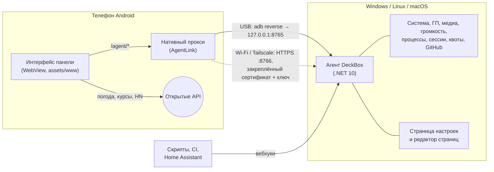

# Руководство разработчика

[К описанию DeckBox](../README.md) · [Установка и подключения](SETUP.md) · [Руководство пользователя](GUIDE.md)

[Как это устроено](#как-это-устроено) · [Разработка](#разработка)

## Как это устроено



- WebView никогда не обращается к ПК напрямую: запросы к `/agent/*` перехватывает приложение и пересылает их через
  туннель adb (или защищённое HTTPS-подключение), поэтому нет проблем с CORS, смешанным содержимым и локальной сетью.
- События в реальном времени (смена страниц, уведомления, запросы разрешений) приходят по одному потоку
  server-sent events (`/api/stream`); обычный опрос остаётся запасным вариантом.
- Агент собирает только то, что на экране: списки процессов и виджеты команд работают, только пока телефон на них смотрит.

## Разработка

Помощь приветствуется: сначала прочитайте [CONTRIBUTING.md](../CONTRIBUTING.md) (объём изменений, модель
безопасности, конфиденциальность и тесты).

Для агента нужен .NET 10 SDK, для сборки Android — JDK 17 и Android SDK Platform 35, для браузерных инструментов —
Python 3 и Node.js 22. Gradle Wrapper скачивает Gradle сам.

Команды ниже выполняются из корня репозитория, если не указана другая папка.

### Локальный предпросмотр

```sh
python tools/demo-server.py
```

Сервер работает в этом терминале. Откройте <http://127.0.0.1:8790/panel/> или <http://127.0.0.1:8790/settings/>.
Для других команд используйте второй терминал.

### Проверки

```sh
dotnet test agent/DeckBox.Agent.Tests
```

Браузерным тестам нужны Node.js 22 и Chromium:

```sh
cd tools/ui-tests
npm ci
npx playwright install chromium
npx playwright test
```

В CI на Linux используйте `npx playwright install --with-deps chromium`. Playwright сам запускает демо на порту 8781.
Тесты работают с английскими данными демо; посетители сайта видят русские.

### Сборка и запуск

В Windows из корня репозитория:

```powershell
.\scripts\build.ps1 # APK и архивы агента в dist/
```

Только приложение Android с проверкой совместимости API:

```powershell
cd android
.\gradlew.bat lintDebug assembleDebug
```

Агент для Windows из корня репозитория:

```powershell
dotnet run --project agent/DeckBox.Agent -f net10.0-windows10.0.19041.0
```

В Linux или macOS агент запускается командой `dotnet run --project agent/DeckBox.Agent -f net10.0`, а APK
собирается через `cd android && ./gradlew assembleDebug`. В Windows явный `-f` выбирает одну из двух целевых
платформ проекта. Укажите путь к Android SDK в `ANDROID_HOME` или в `android/local.properties` (`sdk.dir`).

### Установщик для Windows

[`installer/build.sh`](../installer/build.sh) собирает в Linux все файлы релиза: установщик
`DeckBox-Setup-<версия>.exe` (NSIS, на русском, без прав администратора), архив агента
`DeckBoxAgent-<версия>-win-x64.zip` для встроенного обновления, `DeckBox-<версия>.apk` и `SHA256SUMS-<версия>.txt`.
Нужны .NET 10 SDK, JDK 17, Android SDK, `makensis` (`apt install nsis`), `zip` и ключ подписи (см. ниже).

### Демо-данные и медиа

Демо-серверу нужен только Python. Он отдаёт то же демо, что и [сайт](https://dubstep2004.github.io/DeckBox/)
(придуманные данные в [`tools/pages/demo.js`](../tools/pages/demo.js)), прямо из исходников, поэтому после
перезагрузки видны ваши изменения. Задайте окну браузера размер 780 × 360 (экран телефона в CSS-пикселях), и панель
поведёт себя как на телефоне, включая вебхуки: `curl -X POST http://127.0.0.1:8790/api/notify -d hello` (а также
`/api/push/<key>`, `/api/goto/<page>` и `/api/ask` для придуманного запроса разрешения).

Пока демо-сервер работает, медиа создаются из второго терминала:

```sh
cd tools/ui-tests
node media.js shots home system
node media.js tour
node media.js hero
```

Сначала установите браузерные инструменты выше. Для тура нужен ещё FFmpeg. Значок DeckBox PRO хранится в
[`docs/brand/deckbox-icon.svg`](brand/deckbox-icon.svg); из него сделаны значки Android, `deckbox.ico` и значок сайта.

### Структура исходников

Панель написана на обычных ES-модулях: [`main.js`](../android/app/src/main/assets/www/main.js) (ядро, страницы,
навигация, данные от агента) и виджеты в [`widgets/`](../android/app/src/main/assets/www/widgets). Виджет — это
запись `{ needs, create(box, ctx) → { update(kind) } }` в реестре `W`, его стили в `style.css` и описание в каталоге
(название, размер, параметры) в [`widgets.json`](../agent/DeckBox.Agent/widgets.json), по которому строится редактор
настроек. Шаблоны лежат в [`templates.json`](../agent/DeckBox.Agent/templates.json). Переводы — в
[`i18n.js`](../android/app/src/main/assets/www/i18n.js) (ключи и каталог виджетов) и
[`i18n-ru-dom.js`](../android/app/src/main/assets/www/i18n-ru-dom.js) (русские надписи страницы настроек, которые
пишутся напрямую).

### Отдельный запуск агента

Чтобы проверить агент разработки рядом с установленным, запустите его с отдельным файлом настроек и портом, например
`DeckBoxAgent.exe --config "D:\test folder\config.json" --port 18765`. Настройки и браузерные проверки используют
`http://127.0.0.1:18765/`; перезапуск сохраняет эти аргументы. Обычный порт остаётся 8765. В тестовых настройках
явно задайте `deviceSerial` (несовпадающий серийный номер отключает подключение по USB) и выключите автообновление.
USB-клиенты всё равно используют порт телефона 8765; не назначайте один телефон двум агентам сразу.

### Подпись и выпуск

Релизные APK подписываются ключом DeckBox, если заданы `DECKBOX_STORE_FILE`, `DECKBOX_STORE_PASSWORD`,
`DECKBOX_KEY_ALIAS` и `DECKBOX_KEY_PASSWORD` (в `~/.gradle/gradle.properties` или в переменных окружения); иначе
используется отладочный ключ. Отладочные сборки позволяют отлаживать WebView через `chrome://inspect`.

Чтобы выпустить версию: поднимите номер версии в `DeckBox.Agent.csproj` и `android/app/build.gradle.kts`
(и `versionCode`), отправьте изменения и запустите workflow **DeckBox release** во вкладке Actions (или отправьте тег
`v<версия>`). Он соберёт установщик, APK, архив агента и контрольные суммы и опубликует их в релизе. Для подписи
нужны секреты репозитория `DECKBOX_KEYSTORE_BASE64` и `DECKBOX_KEYSTORE_PASSWORD`. Установленные агенты DeckBox
сами находят новый релиз и обновляют себя и приложение на телефоне.
